# TS Academy DevOps Capstone 2 — Stan's Robot Shop

## Project Overview

This project implements the monitoring, logging, distributed tracing, alerting, and incident-management requirements for **TS Academy DevOps Capstone 2: Stan's Robot Shop**.

Robot Shop runs on Amazon EKS. The project uses Prometheus and Grafana for monitoring, Fluent Bit and Loki for centralized logging, OpenTelemetry and Jaeger for distributed tracing, and Alertmanager with Slack for alert notifications.

**GitHub Repository:** https://github.com/Adedoyin007/robot-shop

**AWS Region:** `eu-west-2`

**Kubernetes Cluster:** `voting-app-eks`

**Application Namespace:** `robot-shop`

**Monitoring Namespace:** `monitoring`

## 1. Project Architecture

The application runs on Kubernetes. Prometheus collects metrics, Grafana displays monitoring dashboards, Fluent Bit forwards logs to Loki, and OpenTelemetry instrumentation sends Cart traces to Jaeger. Alertmanager routes matching alerts to a Slack channel.

### Architecture components

- **Amazon EKS:** Kubernetes platform for Robot Shop.
- **Prometheus:** Metrics collection and alert evaluation.
- **Grafana:** Monitoring dashboards and log exploration.
- **Fluent Bit and Loki:** Log collection, storage, and search.
- **OpenTelemetry and Jaeger:** Distributed tracing for the Cart service.
- **Alertmanager and Slack:** Alert notifications.
- **Kubernetes Prometheus Operator:** Manages monitoring rules and Alertmanager configuration.

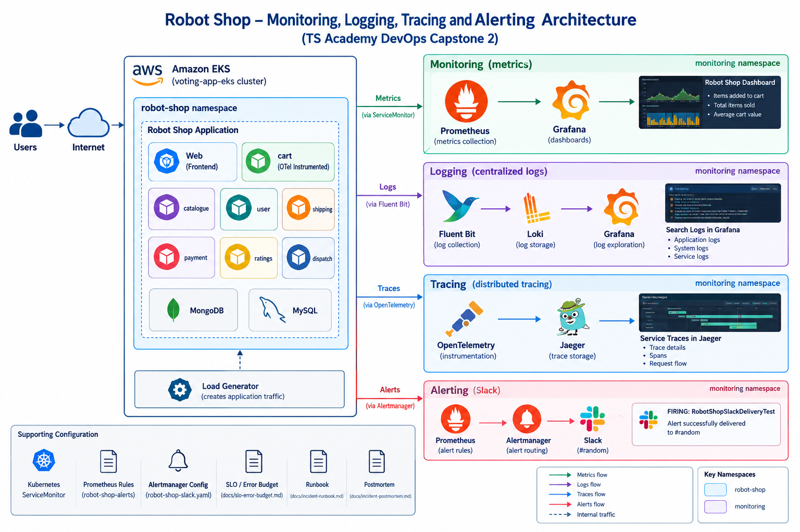

*Screenshot 1: Robot Shop project architecture and monitoring components.*

## 2. Step One — Deploy Robot Shop and Verify Application Health

Robot Shop was deployed to the existing EKS cluster in the `robot-shop` namespace. The application includes its web frontend, backend services, and supporting datastores.

A load generator was also used to create application traffic for monitoring and testing.

### Verification

The Kubernetes workload status was checked to confirm that the application pods were running. The web frontend and results from application activity were also checked during the deployment process.

Commands used for verification included:

```bash
kubectl get pods -n robot-shop
kubectl get services -n robot-shop
kubectl get deployments -n robot-shop
```

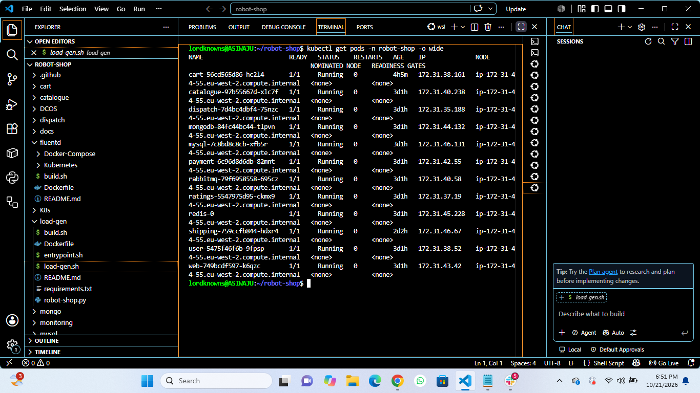

*Screenshot 2: Robot Shop application pods running in the `robot-shop` namespace.*

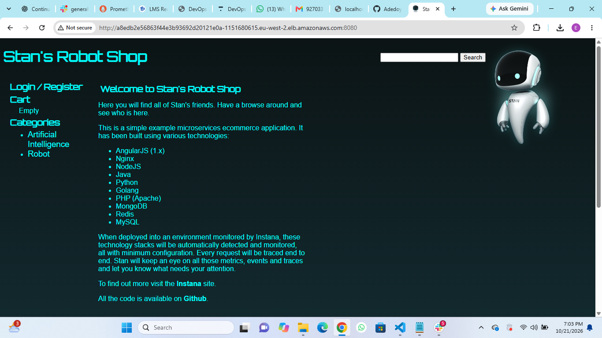

*Screenshot 3: Robot Shop web application running successfully.*

## 3. Step Two — Install Monitoring and Configure Grafana

The `kube-prometheus-stack` Helm chart was installed in the `monitoring` namespace. This provided Prometheus, Grafana, Alertmanager, and supporting monitoring components.

Grafana was accessed through Kubernetes port forwarding:

```bash
kubectl port-forward -n monitoring svc/monitoring-grafana 3000:80
```

Grafana was then opened at `http://localhost:3000`.

### Dashboard export

The Grafana dashboard was exported and committed to the repository:

`monitoring/grafana/robot-shop-application-metrics.json`

The dashboard, titled **Robot Shop - Requests, Errors, Latency**, combines business metrics and HTTP application metrics.

**Dashboard panels:**
- Total items added to cart.
- Total items sold.
- Average cart value over five minutes.
- HTTP requests per second.
- HTTP 5xx errors per second.
- HTTP request latency at the 95th percentile (p95).
- HTTP status-code breakdown.

The HTTP metrics are currently instrumented for the Cart service. The 5xx error panel may display “No data” when no matching server errors have been recorded.

**Accessing Grafana**

Start port forwarding from the terminal:

```bash
kubectl port-forward -n monitoring svc/monitoring-grafana 3000:80
```

Open `http://localhost:3000` in a browser and navigate to the **Robot Shop - Requests, Errors, Latency** dashboard.

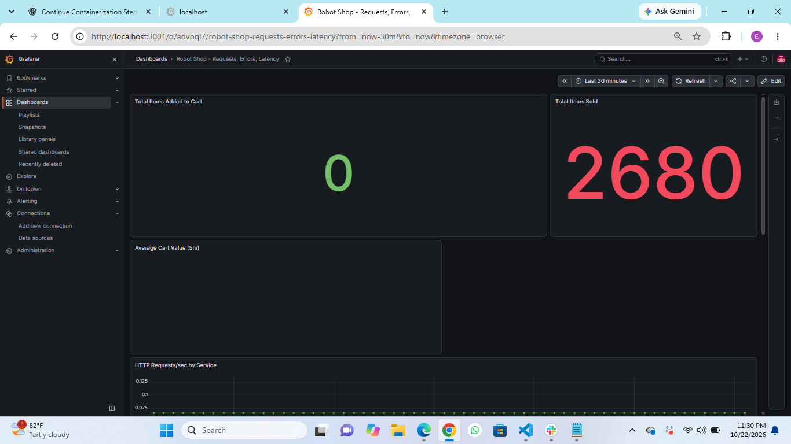

*Screenshot 4a: Grafana dashboard showing the top panels and Robot Shop business metrics.*

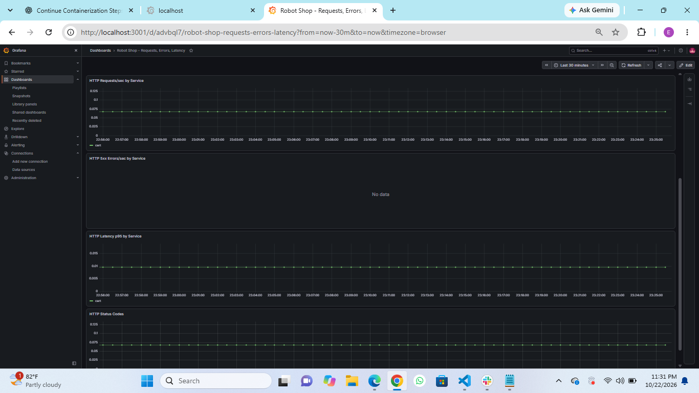

*Screenshot 4b: Grafana dashboard showing the remaining HTTP request, error, latency, and status-code panels.*

## 4. Step Three — Configure Centralized Logging

Fluent Bit was configured to collect application logs and forward them to Loki. Grafana was used to query and inspect the collected logs.

The Loki datasource was configured with the in-cluster service address:

`http://loki.monitoring.svc.cluster.local:3100`

The datasource also uses the `X-Scope-OrgID` header with value `1`.

### Verification

Logs were searched in Grafana to confirm that the logging pipeline was operational. Log exploration was used to inspect application output and investigate service behaviour.

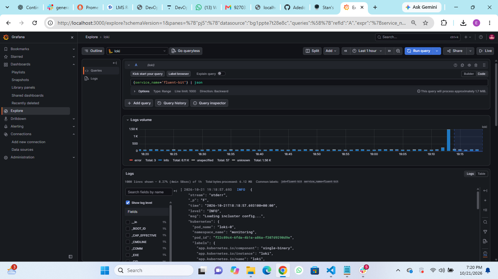

*Screenshot 5: Centralized application logs queried through Grafana Explore and Loki.*

## 5. Step Four — Configure Distributed Tracing

OpenTelemetry instrumentation was added to the Cart service. The instrumented Cart image is:

`asiwaju007/rs-cart:otel`

Jaeger was accessed through port forwarding:

```bash
kubectl port-forward -n monitoring svc/jaeger 16686:16686
```

The Jaeger interface was opened at `http://localhost:16686`.

### Verification

The `cart` service appeared in Jaeger, and application traces were observed. This confirmed that the Cart instrumentation was producing trace data that could be inspected during troubleshooting.

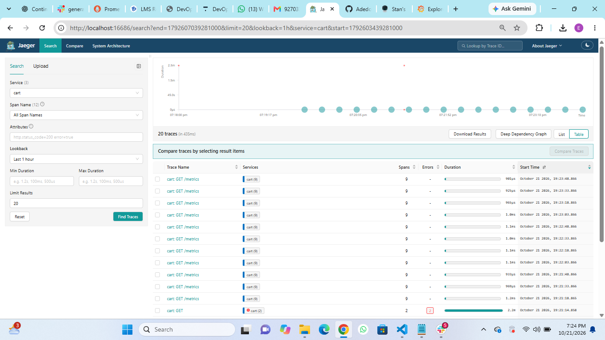

*Screenshot 6: Distributed traces for the Cart service in Jaeger.*

## 6. Step Five — Define the SLO and Configure Slack Alerts

An availability SLO and error-budget policy were documented in:

`docs/slo-error-budget.md`

A Prometheus alert rule was created in:

`monitoring/` — Prometheus rule named `robot-shop-alerts`.

The `RobotShopPodNotReady` alert evaluates the readiness of pods in the `robot-shop` namespace and fires when the expression remains true for five minutes.

The alert includes a runbook reference:

`docs/incident-runbook.md`

### Slack integration

An incoming webhook was created for the Slack channel `#random`. A Kubernetes Secret named `alertmanager-slack-webhook` stores the webhook URL. The URL itself is not committed to Git.

The Alertmanager configuration is stored in:

`monitoring/alertmanager/robot-shop-slack.yaml`

### Verification

A temporary test alert named `RobotShopSlackDeliveryTest` was created with an always-true Prometheus expression. The alert successfully reached Slack, displaying:

`FIRING: RobotShopSlackDeliveryTest`

The temporary test rule was subsequently deleted.

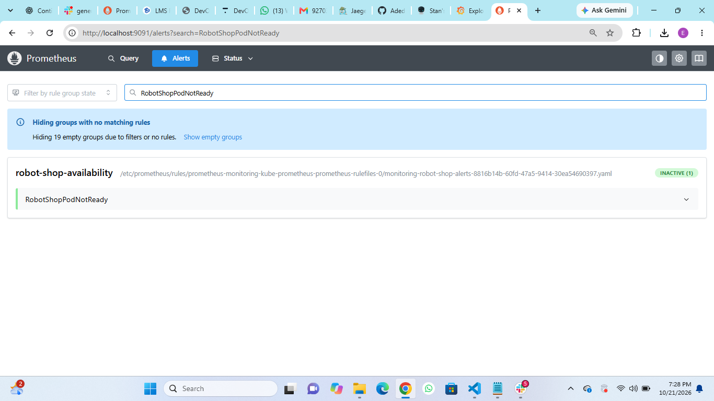

*Screenshot 7: Prometheus alert rule configured for Robot Shop pod availability.*

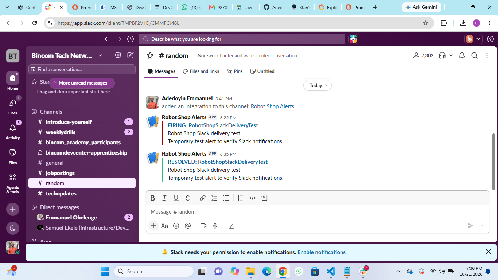

*Screenshot 8: Successful Slack delivery test for Robot Shop alert notifications.*

## 7. Step Six — Perform the Incident Drill

An incident drill was performed by deliberately deleting a Cart pod to test Kubernetes recovery behaviour.

Kubernetes recreated the pod. The incident and recovery observations were documented in:

- `docs/incident-runbook.md`
- `docs/incident-postmortem.md`

The postmortem records the incident, recovery observations, follow-up actions, and blameless analysis.

The drill demonstrated pod recovery. The application root path returned HTTP 404 during one check, so that response should not be treated as proof that a valid Cart API request succeeded.

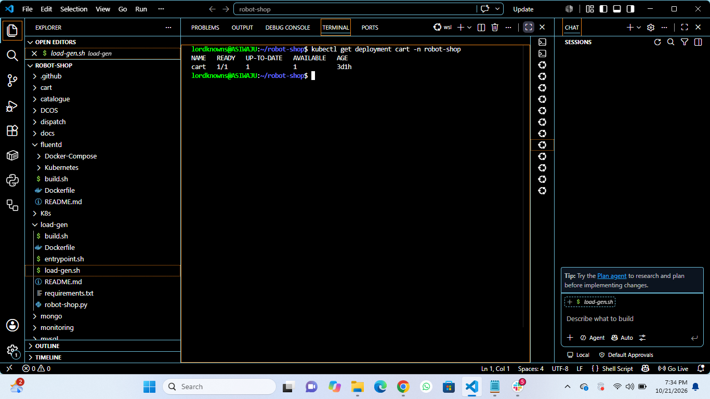

*Screenshot 9: Cart deployment verified healthy after the recovery drill.*

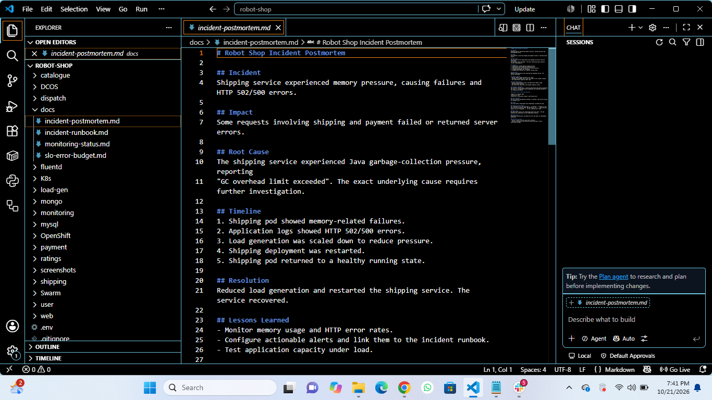

*Screenshot 10: Incident postmortem documenting recovery, root cause, and follow-up actions.*

## 8. NGINX Exporter — Additional Configuration

An NGINX Prometheus exporter manifest was added to:

`monitoring/nginx-exporter/deployment.yaml`

It defines the exporter Deployment, Service, and ServiceMonitor.

**Status:** The manifest is committed to GitHub, but the exporter has not been verified running and its live metrics have not been confirmed. It is therefore documented as additional configuration rather than a completed monitoring component.

## 9. Repository Deliverables

| Deliverable | Location |
|---|---|
| Grafana dashboard export | `monitoring/grafana/robot-shop-application-metrics.json` |
| Slack Alertmanager configuration | `monitoring/alertmanager/robot-shop-slack.yaml` |
| NGINX exporter manifest | `monitoring/nginx-exporter/deployment.yaml` |
| SLO and error-budget policy | `docs/slo-error-budget.md` |
| Incident runbook | `docs/incident-runbook.md` |
| Incident postmortem | `docs/incident-postmortem.md` |
| Implementation evidence | `screenshots/` |

Logging and tracing configuration files are also maintained in the repository's monitoring configuration directories.

## 10. Project Completion Status

The Robot Shop DevOps capstone implementation and documentation have been completed for the project scope described in this repository.

### Completed Deliverables

- Robot Shop application deployed on Amazon EKS.
- Prometheus and Grafana monitoring configured.
- Grafana dashboard exported to JSON with business and HTTP application metrics.
- Dashboard screenshots captured and committed to the repository.
- Loki centralized logging configured, with logs searchable in Grafana.
- Jaeger distributed tracing verified for the Cart service.
- SLO and error-budget policy documented.
- Alert rules and Slack notification integration configured and tested.
- Incident drill, recovery procedure, runbook, and postmortem documented.
- Project documentation and evidence committed to GitHub.

The NGINX Prometheus Exporter manifest is included as additional configuration; its live operation has not been verified.

## 11. Security Notes

- Slack webhook URLs are stored in Kubernetes Secrets and must not be committed to Git.
- Do not include passwords, access tokens, private keys, or webhook URLs in screenshots.
- Redact sensitive account details before publishing evidence.

## Conclusion

This project demonstrates practical DevOps work involving Kubernetes application deployment, monitoring, centralized logging, distributed tracing, alerting, and incident recovery. The repository contains the implementation artifacts, monitoring configuration, operational documentation, and evidence for the capstone submission.
